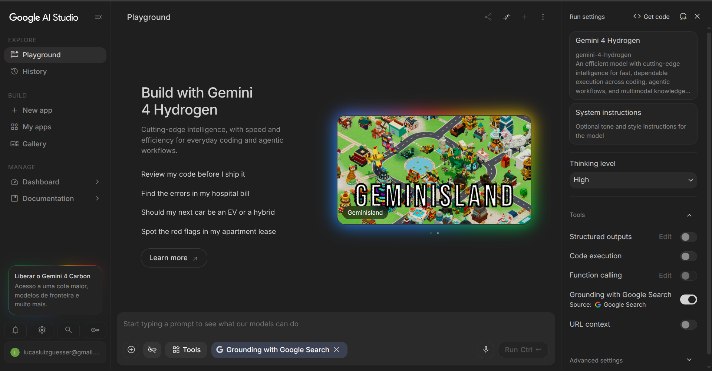
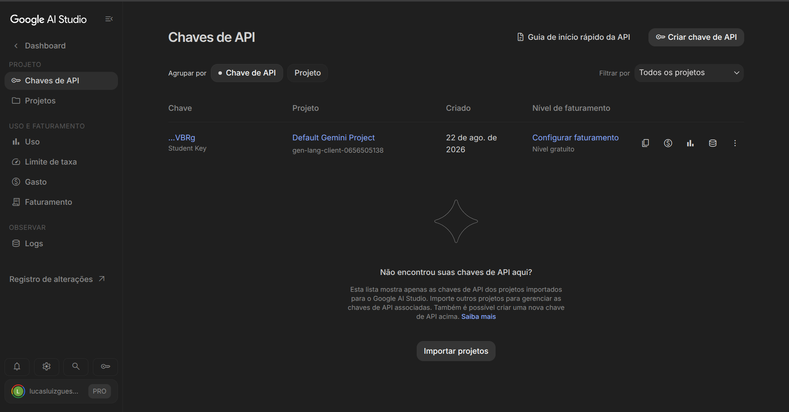
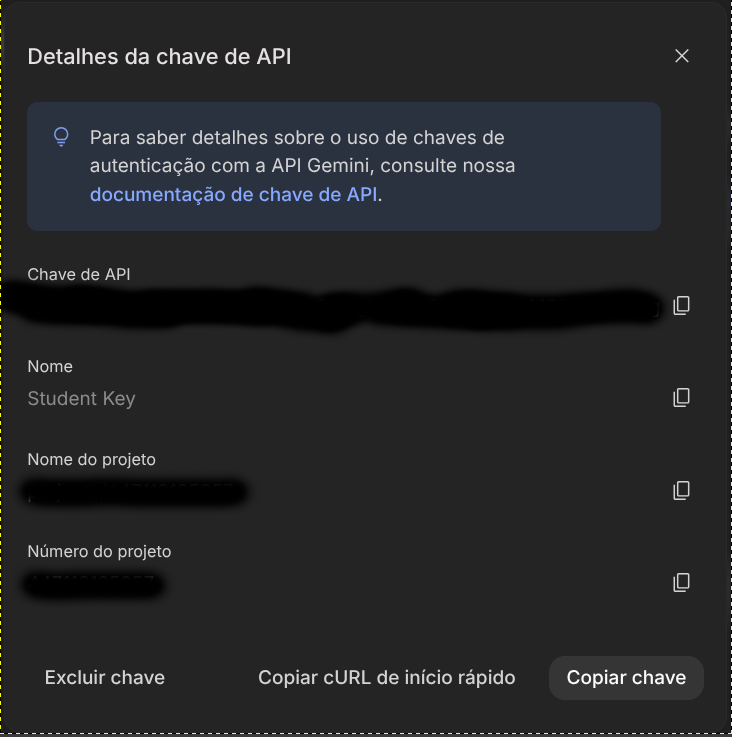
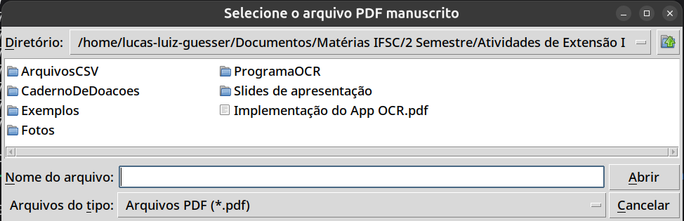
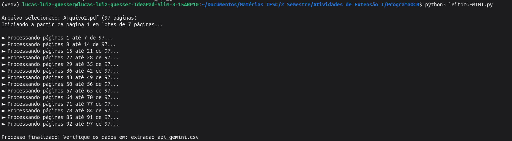

# Dupla: Lucas Luiz Guesser e Bernardo Vieira de Souza.

## Documentação da implementação do software de conversão de manuscritos em PDF para CSV.

### Descrição da implementação:

Nesta implementação temos um software escrito em linguagem Python que lê o arquivo PDF com informações manuscritas a caneta em letra cursiva, e organiza eles em um arquivo CSV que consegue ser organizado em ferramentas como Excel, Google Sheets ou LibreOffice Calc.

### Limitações:

Por conta do software exigir uso de IA na nuvem ele tem um limite de leitura de páginas no plano gratuito, sendo de aproximadamente 128 por dia.

### Como se usa a aplicação:

Primeiramente precisamos criar uma chave API para podermos usar o agente de IA na nuvem. Isso é facilmente feito pelo site [Google AI studio](https://aistudio.google.com/). Quando você logar na sua conta, você verá a seguinte imagem:

Na esquerda, clique em "Dashboard", que aparecerá a seguinte imagem:

No botão no canto superior direito chamado "Criar chave de API", você deve clicar nele, para criar sua chave, posteriormente a chave será criada como já foi na imagem acima. Em seguida deve clicar na opção da chave em Student Key na qual aparecerá as seguintes opções:

Você deve copiar a chave da API e colar na linha 10 do código:

`CHAVE_API=""`

Posteriormente o código deve ser obrigatoriamente executado via terminal, de preferência o Linux. Vá na pasta do arquivo abra o terminal no endereço da pasta e execute o seguinte código para criar o ambiente virtual necessário para funcionamento do software:

`python3 -m venv meu_env`

Use o seguinte código para ativar o ambiente virtual:

`source venv/bin/activate`

Rode o seguinte código para ativar a aplicação:

`python3 leitorGEMINI.py` 

Aparecerá a seguinte interface de aplicação para escolhermos o arquivo PDF com as imagens em manuscrito, selecione o arquivo dentro da pasta que você colocou esse mesmo PDF.

Após selecionar o PDF você clicará em Abrir e seguidamente o programa executará a conversão do PDF como no exemplo abaixo:

Posteriormente o arquivo será convertido diretamente dentro da pasta ProgramaOCR.

Você também pode mudar o modelo de IA no futuro caso queira modificando o trecho da linha 13:

`MODELO = 'gemini-3.6-flash'`